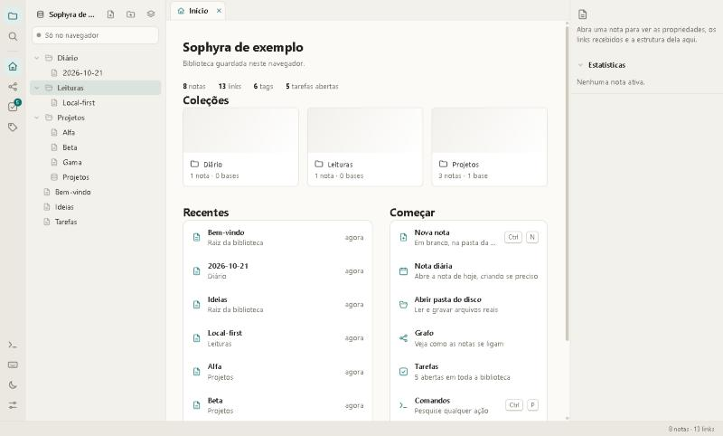
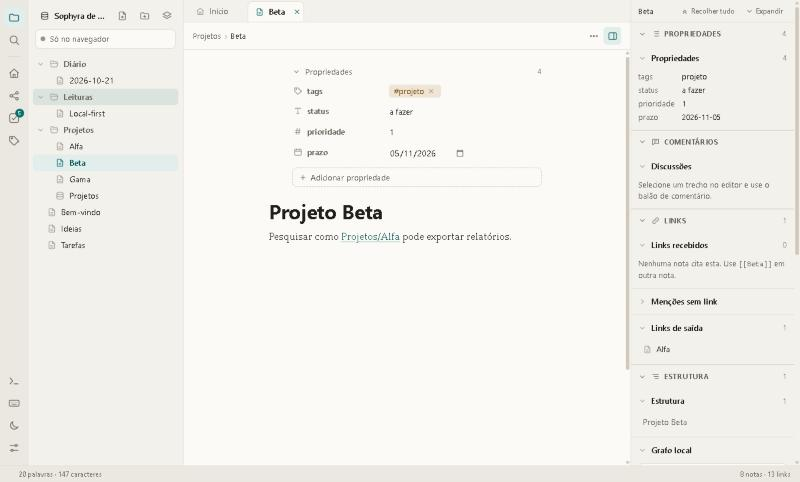
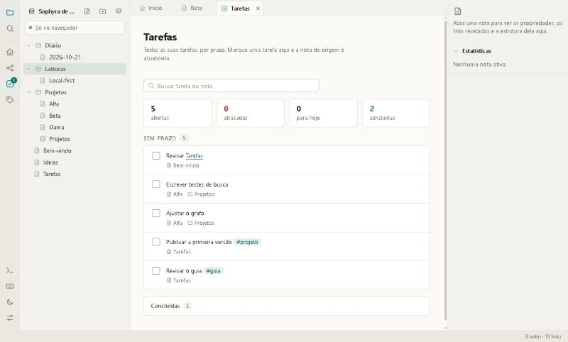
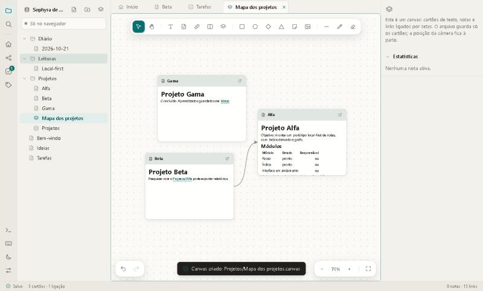
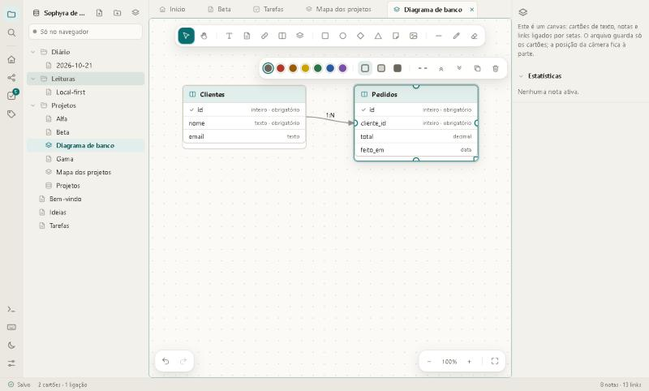

# Sophyra

**Segundo cérebro em Markdown, local-first.** Notas em arquivos de texto, links `[[assim]]`, bases de dados sobre as
suas notas, tarefas por prazo, canvas com diagrama de banco e grafo. Roda no navegador ou como aplicativo desktop, e pode ser servido para outras pessoas. Sem build e sem
dependências em tempo de execução.

> **Beta (`0.1.0-beta.1`).** Funciona e tem mais de 490 testes, mas o formato e a interface ainda podem mudar. Veja o
> [roteiro](#roteiro) e as [limitações](docs/arquitetura.md#limitações-conhecidas).



## O que é

Uma **biblioteca** é o conjunto das suas notas. Cada nota é um arquivo `.md`; cada pasta da raiz vira uma **coleção**
(com capa, ícone e página própria). O app lê esses arquivos e deriva deles o índice, os backlinks, o grafo, as tarefas
e as bases. **O arquivo é a fonte de verdade**: você pode abrir a pasta em qualquer editor, sincronizar com o que
quiser e nunca fica preso ao app.

| | |
|---|---|
|  |  |
| Nota com propriedades, blocos e backlinks | Tarefas de toda a biblioteca, por prazo |
|  |  |
| Canvas com grafo das notas, montado a partir de uma pasta | Diagrama de tabelas e relações |

## Recursos

- **Editor de blocos** com menu `/`, colunas, destaques, toggles, mídia, botões, datas e menções `@`; tudo volta como
  Markdown ao salvar.
- **Links e grafo**: `[[Nota]]`, `[[Nota#Seção]]`, backlinks, menções sem link, tags e grafo com física.
- **Bases** (tabela, lista, quadro, calendário, galeria e cronograma) sobre as propriedades das notas, com filtros,
  ordenação, agrupamento, totais, relações, pessoas e fórmulas. A base não guarda dados: cada linha é uma nota.
- **Wiki** (documentos) separada de **base de dados** (registros), com modelos prontos.
- **Tarefas** de toda a biblioteca, agrupadas por prazo, com marcação direta.
- **Canvas**: cartões, notas, formas, imagens, ligações, **tabelas e relações** (exporta DBML e SQL), **grafo de notas**
  que se atualiza sozinho e um esquema JSON para [agentes](docs/agentes.md).
- **Coleções** com capa, ícone, página e cartões; árvore com arrastar, seleção múltipla e renomear pastas.
- **Pasta real do disco** (Chrome/Edge): lê e grava arquivos de verdade, com atualização de links ao renomear.
- **Desktop (Electron)** com várias **bibliotecas** (cada uma é uma pasta), troca sem fechar e perfil local.
- **Servir** a biblioteca na rede com contas (dono, editor, leitor) e **conectar** a outro servidor; as mudanças chegam
  aos outros em tempo real. Veja [Desktop, servidor e conexão](docs/servidor.md).
- **Servidor MCP** com 15 ferramentas para agentes lerem, buscarem e escreverem (sem apagar), por stdio ou HTTP.
  Veja [Sophyra e agentes](docs/agentes.md).
- **Plugins** locais com permissões declaradas, **snippets de CSS**, tema claro e escuro, paleta de comandos, abas,
  painel dividido e espaços de trabalho salvos.
- Catálogo de **ícones** Lucide (mais de mil) com seletor.

## Começando

Precisa só do [Node.js](https://nodejs.org) 22 ou mais novo (para o servidor local e os testes; o app em si é HTML,
CSS e módulos ES).

```bash
git clone https://github.com/Kaykygnb/sophyra.git
cd sophyra
npm start          # http://127.0.0.1:8080
npm test           # testes (node:test)
```

Outros modos:

```bash
npm install && npm run desktop                  # aplicativo desktop (Electron)
node bin/sophyra-server.mjs --pasta /notas --dono Maria   # servir uma pasta na rede
node bin/sophyra-mcp.mjs --pasta /notas         # MCP por stdio para um agente
```

Abra `http://127.0.0.1:8080`. Na primeira vez uma biblioteca de exemplo é criada no navegador. Para trabalhar com
arquivos reais, use **Configurações › Sophyra e pasta › Abrir pasta** (precisa de Chrome ou Edge).

Qualquer servidor de arquivos estáticos serve; `npm start` só evita exigir Python ou pacotes.

## Documentação

| Documento | Conteúdo |
|---|---|
| [Guia de recursos](docs/guia.md) | Tudo que o app faz, tela por tela, com atalhos |
| [Formatos de arquivo](docs/formatos.md) | `.md`, `.base`, `.canvas` e o esquema `sophyra.diagram` |
| [Desktop, servidor e conexão](docs/servidor.md) | Aplicativo desktop, bibliotecas, servir, contas, API e segurança |
| [Sophyra e agentes](docs/agentes.md) | Servidor MCP, ferramentas e o que um agente consegue fazer (e o que não) |
| [Arquitetura](docs/arquitetura.md) | Módulos, fluxo de dados, desempenho e limitações |
| [Design](docs/design.md) | Direção visual, tokens e como estender |
| [Contribuir](CONTRIBUTING.md) | Como rodar, testar e abrir mudanças |
| [Changelog](CHANGELOG.md) | Histórico de versões |

## Como o código é organizado

```
index.html     estrutura da página
styles.css     sistema de design (tokens, componentes, telas)
src/           módulos ES, sem build (lógica pura separada da interface)
plugins/       plugins locais e registry.json
server/        biblioteca em pasta, contas, API HTTP, MCP e registro de bibliotecas (Node, sem dependências)
electron/      casca desktop (processo principal e ponte)
bin/           servidor de rede e servidor MCP por linha de comando
exemplos/      nota e canvas de exemplo
tests/         testes do núcleo (node:test)
tools/         servidor local, gerador de ícones e medição de escala
docs/          documentação
```

A lógica (Markdown, índice, bases, canvas, diagrama, tarefas) fica em módulos sem DOM e é coberta por testes; as
telas ficam em módulos próprios. Detalhes em [docs/arquitetura.md](docs/arquitetura.md).

## Roteiro

O que existe hoje é um app de navegador. O que está decidido ou em estudo, em ordem aproximada:

1. **Instalador do desktop** (`.exe`, `.dmg`) e atualização automática; hoje o desktop roda com `npm run desktop`.
2. **Listas grandes**: paginação ou rolagem virtual (o motor aguenta 20 mil notas; o limite hoje é desenhar todas as
   linhas de uma vez).
3. **HTTPS embutido**, convite por link e OAuth no MCP remoto; hoje o servidor de rede depende de rede confiável ou de proxy com TLS.
4. **Plugins isolados** (iframe com permissões) no lugar do isolamento só por API.
5. **Núcleo em Rust com Tauri e SQLite** como índice, mantendo os arquivos como fonte de verdade.
6. **Espaço privado e espaço compartilhado**, com permissões por área.

Nada disso está no código ainda. O que já existe (desktop, bibliotecas, servir, conectar e MCP) está em
[docs/servidor.md](docs/servidor.md). As ideias que dependem de decisão ficam registradas em
[docs/agentes.md](docs/agentes.md) e [docs/arquitetura.md](docs/arquitetura.md).

## Licença e créditos

O código é [MIT](LICENSE). Os ícones são do [Lucide](https://lucide.dev) (ISC); veja [THIRD_PARTY_NOTICES.md](THIRD_PARTY_NOTICES.md). O app não
depende de nenhum pacote em tempo de execução.
