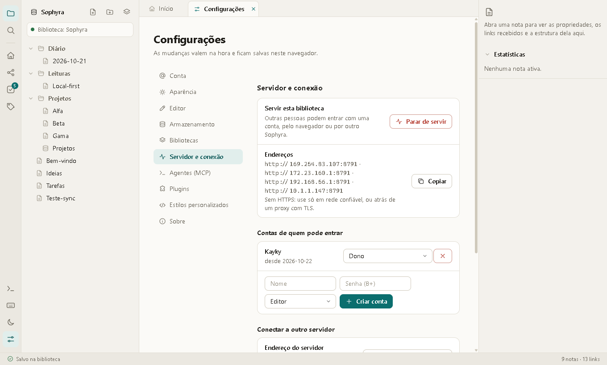

# Desktop, servidor e conexão

O Sophyra roda de três jeitos, todos com a mesma interface e a mesma pasta de notas como fonte de verdade:

| Modo | Como abre | Onde ficam as notas |
|---|---|---|
| **Navegador** | `npm start` e abrir o endereço | No navegador, ou numa pasta conectada (Chrome/Edge) |
| **Desktop** (Electron) | `npm run desktop` | Em pastas do disco; uma lista de bibliotecas |
| **Servidor** | `npm run servidor` (ou o botão **Servir** do desktop) | Em uma pasta, acessada por outras pessoas com contas |



## Desktop

```bash
npm install        # baixa o Electron (só desenvolvimento)
npm run desktop
```

Na primeira vez, o app cria `Documentos/Sophyra` com as notas de exemplo. Depois:

- **Bibliotecas** (Configurações › Bibliotecas): cada biblioteca é uma **pasta**. Adicione, renomeie, troque e tire da
  lista (os arquivos ficam). O app lembra qual estava aberta. Trocar de biblioteca não fecha o app.
- **Conta** (Configurações › Conta): nome e uma linha sobre você. O nome assina seus comentários. É um perfil local,
  guardado só neste computador.
- **Observação de pasta**: se você editar uma nota em outro programa, a mudança aparece no app na hora.
- Por baixo, o desktop abre um servidor **só em `127.0.0.1`** (porta 47821, ou livre se estiver ocupada) e a janela fala
  com ele. Sem login, mas só aceita pedidos da própria máquina e recusa páginas de outros sites (veja
  [Segurança](#segurança)).

> O desktop ainda **não tem instalador** (`.exe`, `.dmg`). Hoje roda com `npm run desktop` a partir do código; empacotar
> está no [roteiro](../README.md#roteiro).

## Servir a biblioteca

Servir deixa outras pessoas entrarem na sua biblioteca, pelo navegador ou por outro Sophyra, cada uma com a sua conta.

### Pelo desktop

1. Configurações › **Servidor e conexão** › crie uma conta de **dono** (nome e senha de 8+ caracteres).
2. Escolha a porta (padrão 8787) e quem alcança (**Rede** ou **Só aqui**) e clique **Servir**.
3. O app mostra os endereços (`http://192.168.0.10:8787`). Passe-os às pessoas e crie as contas delas.

### Num servidor (sem interface)

```bash
node bin/sophyra-server.mjs --pasta /dados/notas --dono Maria     # na primeira vez: pede a senha
node bin/sophyra-server.mjs --pasta /dados/notas --porta 8787 --host 0.0.0.0
```

Opções: `--pasta`, `--porta`, `--host`, `--dono <nome>` (cria o dono se ainda não há contas; a senha vem do prompt ou de
`SOPHYRA_SENHA`), `--contas <arquivo>` (padrão: `.sophyra-contas.json` ao lado da pasta). Quem abre o endereço no
navegador vê a tela de entrada e depois o app inteiro.

### Contas e papéis

| Papel | Pode |
|---|---|
| **Dono** | Tudo, inclusive criar, mudar o papel e remover contas |
| **Editor** | Ler e escrever notas |
| **Leitor** | Só ler |

Senhas ficam com `scrypt` e sal próprio; tokens só pelo hash SHA-256. Sempre precisa existir pelo menos um dono. O
servidor de rede **não liga** sem uma conta de dono.

### Várias pessoas ao mesmo tempo

As mudanças chegam aos outros em tempo real (Server-Sent Events): você cria, edita, renomeia ou apaga e os outros veem
na hora. A regra para edição simultânea da **mesma nota** é a última gravação vence; não há mesclagem de texto nem
cursores compartilhados. A pasta do servidor recebe tudo e continua sendo a fonte de verdade.

## Conectar a um servidor

Configurações › Servidor e conexão › **Conectar a outro servidor**: endereço, nome e senha. A biblioteca do servidor
abre no lugar da atual; a sua continua guardada e volta quando você clicar **Desconectar**. Se o servidor cair, o app
mostra "sem conexão" e tenta de novo sozinho; ao voltar, a biblioteca é recarregada. Numa biblioteca servida, importar
e restaurar exemplo ficam desligados.

Quem abre o endereço de um servidor direto no navegador não precisa conectar nada: a página já vem do servidor.

## API

Todas as rotas começam com `/api`. Na rede, exigem `Authorization: Bearer <token>`.

| Rota | O que faz |
|---|---|
| `GET /info` | Nome, versão, contagens e se exige login (pública) |
| `POST /login` | `{name, password}` → `{token, user}` |
| `POST /logout` | Revoga o token |
| `GET /me` | Conta atual |
| `GET /vault` | A biblioteca inteira (`{name, files:[{path, content, mtime}]}`) |
| `GET /events` | Fluxo de mudanças (SSE): `create`, `modify`, `delete`, `rename`, `reset` |
| `GET/PUT/DELETE /files/<caminho>` | Lê, grava (cria ou troca) e apaga |
| `POST /rename` | `{from, to, updateLinks}` |
| `POST /moves` | `{moves:[{from, to, dir}]}` (tudo ou nada) |
| `POST /mcp` | MCP em JSON-RPC; veja [agentes.md](agentes.md) |
| `GET/POST /users`, `PATCH/DELETE /users/<id>` | Contas (só o dono) |

Cabeçalho `X-Client-Id`: identifica quem grava, para o aviso em tempo real não voltar para o autor.

## Segurança

- **Local (`127.0.0.1`, sem login).** Só aceita `Host` local (barra rebinding de DNS), recusa `Origin` de outro site e
  exige `X-Client-Id` para gravar. Uma página aberta no seu navegador não consegue ler nem escrever nas suas notas.
- **Rede (com login).** Todo pedido precisa de token. O CORS é liberado porque não há cookies, então só quem tem o
  token acessa.
- **O que a página recebe.** O servidor entrega só o app (`index.html`, `styles.css`, `src/`, `plugins/`,
  `exemplos/`); código do servidor, testes, documentos e pastas ocultas dão 404.
- **Sem HTTPS embutido.** Senhas e notas trafegam em texto na rede. Use em rede confiável ou atrás de um proxy com TLS
  (Caddy, nginx). Isso é o primeiro item a evoluir antes de expor na internet.
- **Caminhos.** Qualquer caminho que escape da pasta da biblioteca é recusado, na API e nas ferramentas do MCP.
- **Plugins.** Rodam na página, com as permissões de API que declaram (veja o [guia](guia.md#plugins)). Numa biblioteca
  servida, o mesmo vale para quem estiver conectado: ative só plugins que você conhece.

## Limites atuais

- Sem instalador do desktop e sem atualização automática.
- Sem HTTPS, sem convite por link e sem recuperação de senha: o dono cria e remove contas.
- Edição simultânea da mesma nota: a última gravação vence.
- Rodar o servidor de rede e o app no mesmo computador usa o mesmo processo; fechar o desktop para o servidor.
